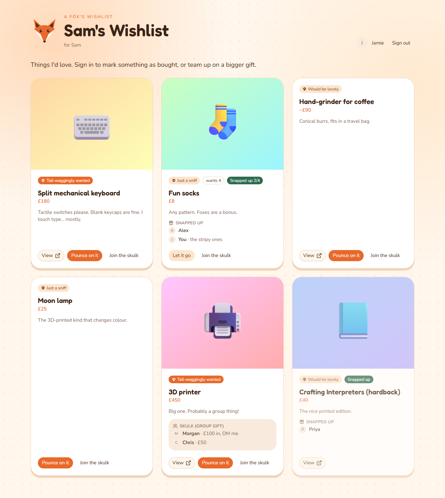
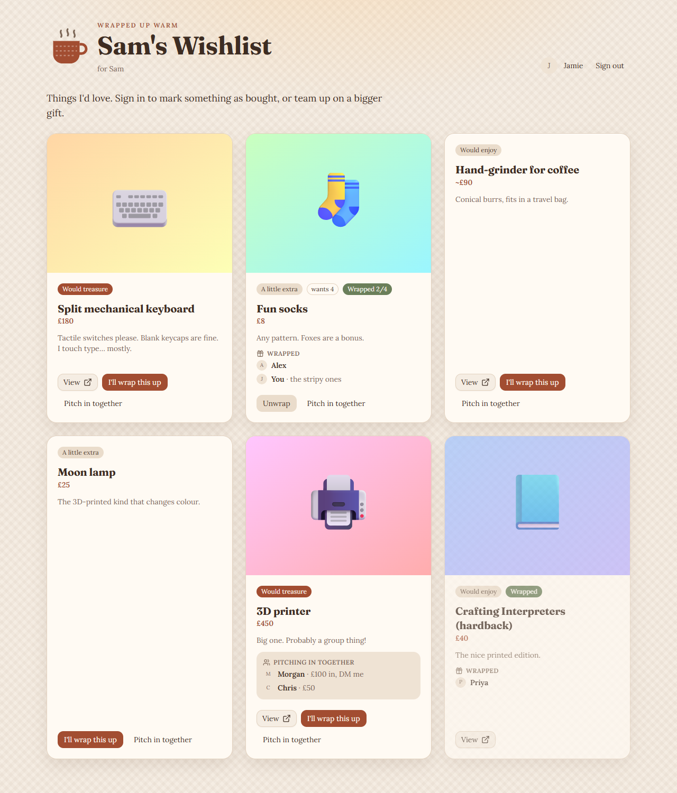
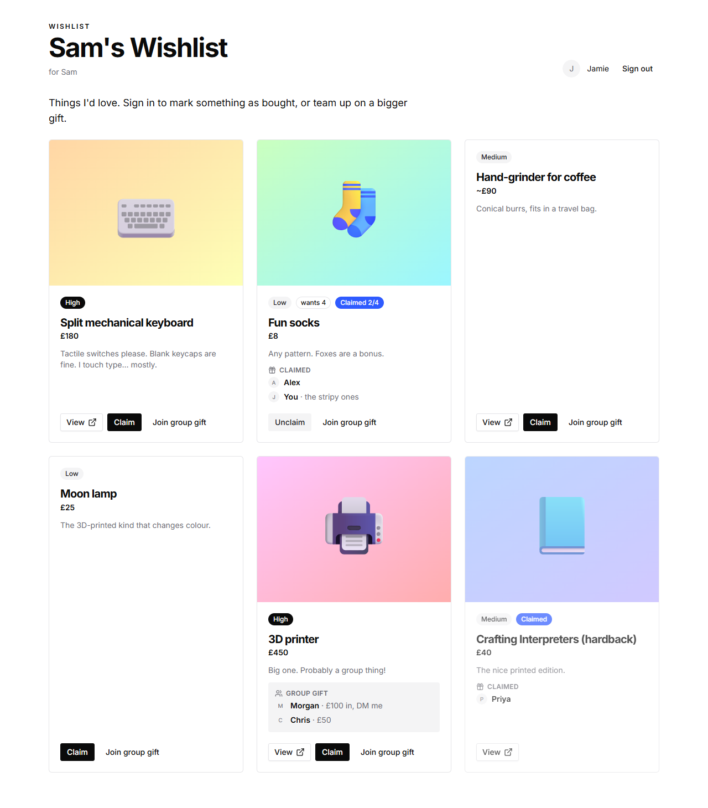
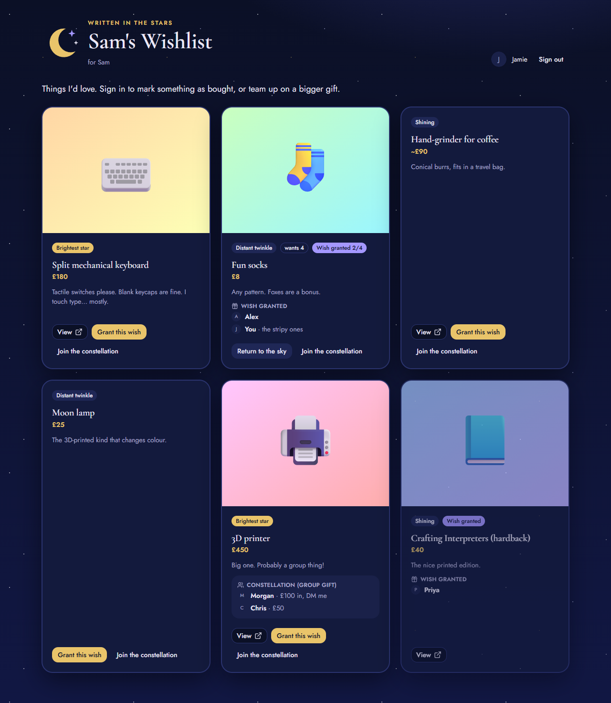
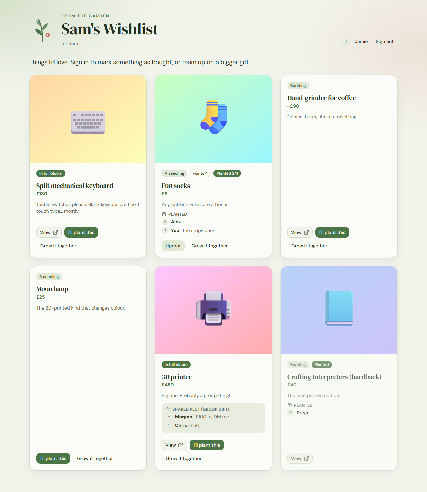
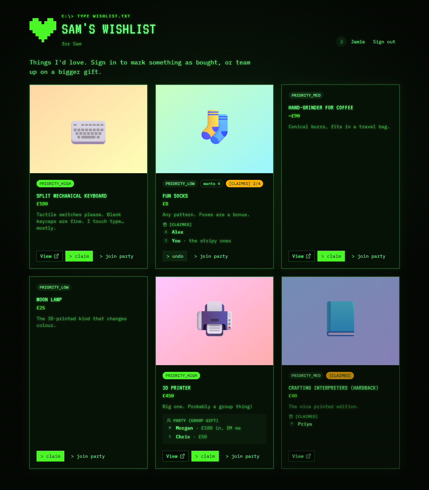

# Wishlist Holder

A small, self-hosted wishlist that runs on Cloudflare's **free plan**. Friends and family sign in
with GitHub or Google, mark gifts as bought, or team up on a group gift. **You, the owner, never
see what's been bought.** The site hides it from you, and the database stores it in a form you
can't read at a glance.

Built with [TanStack Start](https://tanstack.com/start), [shadcn/ui](https://ui.shadcn.com),
[Vite+](https://viteplus.dev), Cloudflare Workers, D1 and Turnstile.



- [Features](#features)
- [Themes](#themes)
- [Deploying your own](#deploying-your-own)
- [Configuration reference](#configuration-reference)
- [Managing your list](#managing-your-list)
- [How surprises stay secret](#how-surprises-stay-secret)
- [Updating](#updating)
- [Local development](#local-development)
- [Troubleshooting](#troubleshooting)

## Features

- **A wishlist** with links, images, prices, priorities and quantities ("wants 4 pairs of socks").
- **Secret claiming.** A signed-in visitor can say "I'm buying this". Other visitors see it, so
  nobody buys the same thing twice. The owner does not see it.
- **Group gifts.** Visitors can join a group for an expensive item and leave a note
  ("£50 in, message me on Signal"). Other members see the group so they can coordinate.
- **Social login** with GitHub and/or Google. Every claim is tied to a signed-in account.
- **Abuse protection**: Cloudflare **Turnstile** bot checks (recommended, works on a
  `workers.dev` address), sign-in, and per-account rate limits.
- **Six themes**, picked in one config file. Theme code is separate from the data.
- **Deploys on push** with Cloudflare Workers Builds.
- **A setup CLI**: `pnpm run configure`.

## Themes

The themes come from six words: **playful** (fox themed), **cozy**, **minimal**, **celestial**,
**botanical** and **retro**. Each theme sets the colours, fonts, artwork and wording (for example
"Pounce on it" or "> claim").

| Playful (fox)                           | Cozy                                    | Minimal                             |
| --------------------------------------- | --------------------------------------- | ----------------------------------- |
|      |            |  |
| **Celestial**                           | **Botanical**                           | **Retro**                           |
|  |  |      |

_The screenshots use made-up example data, as a signed-in gift giver would see it._

**To choose a theme**, do one of these:

- Run `pnpm run configure site` and pick from the list.
- Or set `"theme"` in [`wishlist.config.json`](wishlist.config.json) to `playful`, `cozy`,
  `minimal`, `celestial`, `botanical` or `retro`.

Then commit and push. The site redeploys with the new theme.

**To preview a theme** on your live site before you switch, add `?theme=<name>` to the URL, for
example `https://your-site.workers.dev/?theme=retro`. Only your browser tab changes.

## Deploying your own

You need:

- A free [Cloudflare account](https://dash.cloudflare.com/sign-up).
- A [GitHub account](https://github.com). Your copy of this repository lives there. Cloudflare
  deploys from it.
- [Node.js](https://nodejs.org) **22.18 or later** (24 LTS recommended).
- **pnpm**. This repository pins pnpm `12.18.0` in `package.json` (`packageManager`). If you have
  Corepack (included with Node 22 and 24), run `corepack enable` and the correct version is used
  automatically. Otherwise, install it with `npm install -g pnpm@12.18.0`. If you use
  [Vite+](https://viteplus.dev) (`vp`), it also reads the pin.

### 1. Make your own copy

On GitHub, click **Use this template** (or **Fork**) to make your own repository. Then clone it
and install:

```sh
git clone https://github.com/<you>/<your-repo>.git
cd <your-repo>
pnpm install
```

### 2. Run the setup CLI (recommended)

```sh
pnpm run configure
```

The CLI asks some questions and shows you what to click at GitHub, Google and Cloudflare. It
goes through these steps:

| Step         | What it does                                                                                                                                                                                                                           |
| ------------ | -------------------------------------------------------------------------------------------------------------------------------------------------------------------------------------------------------------------------------------- |
| `site`       | Asks for the title, your name, the intro text and the theme. Saves them to `wishlist.config.json`.                                                                                                                                     |
| `cloudflare` | Logs in to Cloudflare, creates the D1 database, writes its id to `wrangler.jsonc` and creates the tables. Then it deploys once from your computer, which creates the Worker and its URL, and sets the encryption key (`LEDGER_KEY`).   |
| `login`      | Sets up [sign-in](#sign-in): choose GitHub, Google or both. Then enter **your** account, which makes you the owner. The CLI shows the exact OAuth app settings to use and saves the keys to the live site, to `.dev.vars`, or to both. |
| `bot-check`  | Turns on [Turnstile](#bot-protection-and-rate-limits) bot checks (**recommended**). It shows you how to create the widget, then saves the keys. You can say no: sign-in and rate limits still protect the site.                        |
| `dev`        | Writes `.dev.vars` for local development. It can also set up sign-in for `localhost`.                                                                                                                                                  |
| `status`     | Shows what is configured: the settings, which live secrets are set, and `.dev.vars`.                                                                                                                                                   |

Run `pnpm run configure` to go through all of them, or run one at a time, for example
`pnpm run configure login`. When it is done, go to [step 4: commit and push](#4-commit-and-push).

### 3. Or set it up by hand

These are the same steps the CLI does.

**a. Edit `wishlist.config.json`.** At a minimum, set `ownerName`, and set `owners` to your
account (`github:<username>` or `google:<email>`). See the
[configuration reference](#configuration-reference).

**b. Log in to Cloudflare and create the database.**

```sh
pnpm exec wrangler login
pnpm exec wrangler d1 create wishlist
```

Copy the `database_id` from the output into `wrangler.jsonc`, replacing
`00000000-0000-0000-0000-000000000000`. You can change the Worker `name` in `wrangler.jsonc`.
It becomes part of your URL: `https://<name>.<your-subdomain>.workers.dev`.

**c. Create the tables.**

```sh
pnpm run db:migrate:remote
```

**d. Deploy once** to create the Worker and get its URL:

```sh
pnpm run build
pnpm exec wrangler deploy
```

**e. Set the encryption key.** Generate it once and **never change it** (see
[How surprises stay secret](#how-surprises-stay-secret)):

```sh
node -e "console.log(require('crypto').randomBytes(32).toString('base64'))"
pnpm exec wrangler secret put LEDGER_KEY
```

**f. Set up sign-in.** Follow [Sign-in](#sign-in) for GitHub and/or Google.

**g. Turn on Turnstile (recommended).** Follow
[Bot protection and rate limits](#bot-protection-and-rate-limits).

### Sign-in

Visitors must sign in to claim a gift or join a group gift. You can offer GitHub, Google or both.
A provider is turned on when both of its secrets are set. In the steps below, `<your site>` is
your site's address, for example `https://wishlist.you.workers.dev`. Use your custom domain if
you have one.

**GitHub.** Go to [github.com/settings/applications/new](https://github.com/settings/applications/new)
and set:

- Application name: anything, for example your site title.
- Homepage URL: `<your site>`
- Authorization callback URL: `<your site>/auth/callback/github`

Click **Register application**, then click **Generate a new client secret**. Then run:

```sh
pnpm exec wrangler secret put GITHUB_CLIENT_ID
pnpm exec wrangler secret put GITHUB_CLIENT_SECRET
```

A GitHub OAuth app allows only one callback URL. For local development, create a second app with
the callback `http://localhost:3000/auth/callback/github`.

**Google.** In the [Google Cloud console](https://console.cloud.google.com/apis/credentials):

1. Create or pick a project.
2. Set up the **OAuth consent screen** (Google Auth Platform). Choose the audience **External**,
   and enter an app name and your e-mail.
3. Under **Audience**, click **Publish app**. While the app is in _Testing_, only the test users
   you list can sign in.
4. Go to **Clients → Create client** and choose the type **Web application**.
5. Add the authorised redirect URI `<your site>/auth/callback/google`. One client can also serve
   local development: add `http://localhost:3000/auth/callback/google` as well.

Then run:

```sh
pnpm exec wrangler secret put GOOGLE_CLIENT_ID
pnpm exec wrangler secret put GOOGLE_CLIENT_SECRET
```

**Owners.** Add your account to `owners` in `wishlist.config.json`. Use `github:<username>` or
`google:<email>`. For Google, it must be the account's verified e-mail address.

### 4. Commit and push

```sh
git add wishlist.config.json wrangler.jsonc
git commit -m "Configure my wishlist"
git push
```

### 5. Turn on deploy-on-push

In the Cloudflare dashboard, go to **Workers & Pages**. Select your Worker, then go to
**Settings → Builds → Connect**. Choose your GitHub repository and set:

| Setting           | Value                 |
| ----------------- | --------------------- |
| Production branch | `main`                |
| Build command     | `pnpm run build`      |
| Deploy command    | `npx wrangler deploy` |
| Root directory    | `/` (leave empty)     |

The Worker name in the dashboard must match `name` in `wrangler.jsonc`. After you connect, every
push to `main` builds and deploys the site. Workers Builds uses the pnpm version pinned in
`package.json`. To change the Node.js version, edit `.node-version` (it is currently 24).

> **Database migrations on deploy (optional).** By default, the deploy command does not change
> your database. When an update adds a file in `migrations/`, run `pnpm run db:migrate:remote`
> from your computer. To have Cloudflare do this for you, set the deploy command to
> `pnpm run deploy`. Then give the build's API token D1 access: go to **My Profile → API Tokens**,
> edit the token that Workers Builds created, and add the **Account · D1 · Edit** permission. The
> token that Workers Builds creates automatically does not include D1 access.

### 6. Add your wishes

Open your site and sign in with the account in `owners`. Click **Manage list**, or go to `/admin`,
and add items. Then share the link.

## Configuration reference

### `wishlist.config.json` (committed, public)

| Key                | Meaning                                                                                                                                         |
| ------------------ | ----------------------------------------------------------------------------------------------------------------------------------------------- |
| `siteTitle`        | Page title and heading.                                                                                                                         |
| `ownerName`        | Whose list it is ("for Sam").                                                                                                                   |
| `intro`            | A short paragraph under the heading. Can be empty.                                                                                              |
| `theme`            | `playful`, `cozy`, `minimal`, `celestial`, `botanical` or `retro`.                                                                              |
| `owners`           | Who can manage the list and who **can't** see claims. `"github:<username>"` or `"google:<verified email>"`. One or more entries.                |
| `turnstileSiteKey` | The public Turnstile site key. `null` turns Turnstile off. Turning it on is recommended: see [bot protection](#bot-protection-and-rate-limits). |
| `siteUrl`          | Optional. Your site's address, for example `https://wishlist.example.com`. Only the setup CLI uses it, to show OAuth callback URLs.             |

This file is checked when the site builds. A typo, such as an unknown theme, fails the build.
Cloudflare then keeps the previous deploy running.

### Secrets (never committed)

Set these with `pnpm run configure` or `wrangler secret put`. For local development, put them in
`.dev.vars` (copy `.dev.vars.example`, or run `pnpm run configure dev`).

| Secret                                      | Required           | Notes                                                                                           |
| ------------------------------------------- | ------------------ | ----------------------------------------------------------------------------------------------- |
| `LEDGER_KEY`                                | yes                | 32 random bytes, base64. Encrypts claims. **Do not change or lose it**, or all claims are lost. |
| `GITHUB_CLIENT_ID` / `GITHUB_CLIENT_SECRET` | one provider       | GitHub sign-in is turned on when both are set.                                                  |
| `GOOGLE_CLIENT_ID` / `GOOGLE_CLIENT_SECRET` | one provider       | Google sign-in is turned on when both are set.                                                  |
| `TURNSTILE_SECRET_KEY`                      | if Turnstile is on | From your Turnstile widget.                                                                     |

### `wrangler.jsonc`

This file holds the Worker `name`, the D1 database binding (`DB`) and its `database_id`, and the
rate-limit binding (`CLAIM_LIMITER`). It contains no secrets.

## Managing your list

Go to `/admin` while signed in as an owner. There you can add, edit, reorder, hide or delete items.

- **Hide** an item to take it off the list but keep it. Claims on it are kept.
- **Delete** an item to remove it permanently. Any claims on it are never shown again.
- **How many** lets one item be claimed several times (for example, "wants 4").

You can't claim your own items. Your list page shows a note in place of claim details.

## How surprises stay secret

There are two layers of protection:

1. **The site hides claims from you.** Claims and group members are only sent to signed-in
   accounts that are not in `owners`. Signed-out visitors don't see them either, so you can't
   just sign out to look.
2. **The database stores claims in an unreadable form.** Claims live in a table called
   `sync_state`. Each real row is AES-256-GCM encrypted with `LEDGER_KEY`. No item, person or time
   is stored in plain text. The table also contains **decoy rows**: random bytes of the same shape
   and length. These fail the encryption's authentication check, so the site ignores them. Decoys
   are added when you create an item and alongside each claim. This means the number of rows
   doesn't tell you how many claims there are. See [`src/server/ledger.ts`](src/server/ledger.ts).

**Limits.** This protects against a casual look, not against you. As the owner, you hold
`LEDGER_KEY` and the code. You could also sign in with a second account that isn't in `owners`.
If you want the surprise, don't do these things.

Because `LEDGER_KEY` encrypts every claim, changing or losing it makes all existing claims
unreadable. They then look like decoys. `pnpm run configure cloudflare` never replaces a key that
is already set.

### Bot protection and rate limits

Every claim and group join needs a signed-in account. On top of that:

- **Turnstile (strongly recommended).** [Turnstile](https://developers.cloudflare.com/turnstile/)
  is Cloudflare's free CAPTCHA alternative. It checks that a person, not a script, is claiming.
  It works on your `workers.dev` address, so you don't need a domain. A fresh copy of this
  repository has it off (`"turnstileSiteKey": null`), because you must create your own widget
  first.
- **Rate limits (always on).** The Workers
  [Rate Limiting binding](https://developers.cloudflare.com/workers/runtime-apis/bindings/rate-limit/)
  (`CLAIM_LIMITER` in `wrangler.jsonc`) allows each account 10 claim actions per minute. Cloudflare
  counts these separately in each of its locations, so the limit is approximate. The server also
  enforces exact limits per account: at most 6 new claims per minute and 40 open claims. You can
  change these values in `wrangler.jsonc` and at the top of
  [`src/functions/wishlist.ts`](src/functions/wishlist.ts).

You can leave Turnstile off. The site still works, protected by sign-in and the rate limits.

To turn on Turnstile, run `pnpm run configure bot-check`, or do it by hand:

1. In the Cloudflare dashboard, go to **Turnstile → Add widget**.
2. Add your site's hostname, for example `wishlist.you.workers.dev`. Add your custom domain too, if
   you have one. Choose the **Managed** mode.
3. Put the **site key** in `wishlist.config.json` as `turnstileSiteKey`.
4. Run `pnpm exec wrangler secret put TURNSTILE_SECRET_KEY` and paste the **secret key**.
5. Commit and push.

The dev server always uses Cloudflare's test keys when Turnstile is on. These keys always pass.

## Updating

To get improvements from the original repository:

```sh
git remote add upstream https://github.com/<original-owner>/wishlist-holder.git   # once
git fetch upstream
git merge upstream/main
pnpm install
pnpm run db:migrate:remote   # if the update added files in migrations/
git push
```

Your `wishlist.config.json` and `wrangler.jsonc` may conflict during the merge. Keep your values.

## Local development

```sh
pnpm install
pnpm run configure dev   # writes .dev.vars and can set up local sign-in
pnpm dev                 # applies local migrations, then starts http://localhost:3000
```

The dev server runs your code in the real Workers runtime (`workerd`) with a local D1 database in
`.wrangler/`. To sign in locally, you need OAuth keys for `localhost`. `pnpm run configure dev`
walks you through this, or see [Sign-in](#sign-in).

Useful commands:

| Command                                 | What it does                                                                          |
| --------------------------------------- | ------------------------------------------------------------------------------------- |
| `pnpm dev`                              | Starts the dev server.                                                                |
| `pnpm run build`                        | Builds for production into `dist/`.                                                   |
| `pnpm run check`                        | Runs format, lint and type checks (Vite+: Oxfmt, Oxlint, TypeScript).                 |
| `pnpm test`                             | Runs the unit tests (Vitest through Vite+).                                           |
| `pnpm run screenshots`                  | Regenerates `docs/themes/*.png` from the dev-only `/demo` page. Needs Chrome or Edge. |
| `pnpm run db:migrate:local` / `:remote` | Applies the files in `migrations/` to the local or remote database.                   |
| `pnpm run cf-typegen`                   | Regenerates `worker-configuration.d.ts` after you change `wrangler.jsonc`.            |

`/demo?theme=<name>&view=guest|owner|anon` shows the page with made-up data. It only works on the
dev server.

### Project layout

```
wishlist.config.json      site settings (data about the site, not presentation)
wrangler.jsonc            Cloudflare Worker and D1 binding
migrations/               D1 schema
scripts/configure.ts      setup CLI
scripts/screenshots.ts    README image generator
src/
  config.ts               loads and checks wishlist.config.json
  lib/types.ts            data shapes that the UI renders
  server/                 server-only: D1, sessions, OAuth, Turnstile, ledger
  functions/              server functions that the UI calls
  routes/                 pages (/, /admin, /demo) and /auth/* endpoints
  components/             UI built from shadcn/ui and theme tokens only
  themes/
    registry.ts           theme names, fonts and wording
    themes.css            colour, shape and background tokens per theme
    decor.tsx             theme artwork (the fox and others)
  demo/fixtures.ts        made-up data for /demo and screenshots
```

### Adding a theme

1. Add an entry to `THEME_IDS` and `THEMES` in `src/themes/registry.ts`.
2. Add a `[data-theme="<id>"]` block to `src/themes/themes.css` that defines every token listed
   at the top of that file.
3. Optional: add artwork to `MASCOTS` in `src/themes/decor.tsx`.
4. Run `pnpm run screenshots` and add the new image to this README.

Components only use the semantic tokens, such as `bg-card`, `text-primary` and `font-display`. A
theme never needs to change a component.

## Troubleshooting

- **"Site configuration problem: the secret … is not set".** A secret is missing. Run
  `pnpm run configure status` to see which one. For local development, check `.dev.vars`.
- **The sign-in buttons are missing.** No sign-in provider is configured. Both the client id and
  the client secret must be set. Run `pnpm run configure login`.
- **Sign-in returns to `/?login=failed`.** The OAuth callback URL doesn't exactly match your
  site's address, including `https`, or the client secret is wrong. If you moved to a custom
  domain, update the callback URLs.
- **Google says "access blocked" or only some people can sign in.** The consent screen is still
  in _Testing_. Publish it (see [Sign-in](#sign-in)).
- **"The bot check failed".** The Turnstile site key and secret key are from different widgets,
  or your site's hostname isn't added to the widget. If you added a custom domain, add it to the
  widget too.
- **"Slow down a little".** The account hit a rate limit. Wait a minute and try again.
- **`no such table: items`.** Run `pnpm run db:migrate:remote`, or `pnpm run db:migrate:local`
  for the dev server.
- **The build fails on Cloudflare after you edit the config.** Check the build log. It names the
  invalid field in `wishlist.config.json`.
